<div align="center">

# Práctica 5 – Libros P5
### Kotlin Multiplatform · Android

**Instituto Politécnico Nacional**<br>
**Escuela Superior de Cómputo (ESCOM)**

Ingeniería en Sistemas Computacionales · Plan 2020<br>
Unidad de aprendizaje: **Desarrollo de aplicaciones móviles nativas**

**Práctica 5:** Consulta de bases de datos vía APIs y funcionalidades específicas en aplicaciones multiplataforma

| Alumnos | Grupo |
|---|:---:|
| Caballero Pérez Julio César | 7CV4 |
| Velazquez Beltran Brandon | 7CV4 |

Fecha de entrega: 6 de noviembre de 2026

</div>

> 🇬🇧 English version below.

Aplicación móvil con **Kotlin Multiplatform + Compose Multiplatform** que consume el backend REST propio (continuación de la Práctica 2) y la API pública **Open Library**. Incluye búsqueda, historial, favoritos, recomendaciones verificables, inicio de sesión con Google, rol administrador, caché local con SQLDelight y sincronización con cola de operaciones pendientes.

> **Alcance de esta entrega:** Sólo se implementa y prueba el destino **Android** (API 24+). Toda la lógica, la base local, el cliente HTTP y la interfaz están en `commonMain`; lo específico de Android está aislado en `androidMain/platform` (ver «Arquitectura»).

---


## Requisitos

| Herramienta | Versión |
|---|---|
| Android Studio | Ladybug 2024.2 o superior (con plugin Kotlin Multiplatform recomendado) |
| JDK | 17 (el que incluye Android Studio) |
| Android SDK | compileSdk 35, minSdk 24 (Android 7.0) |
| Emulador/dispositivo | Android 7.0+ **con Google Play** (para el inicio con Google) |
| Docker Desktop | 4.6 con Docker Compose v2 |

Versiones principales: Kotlin 2.1.20 · Compose Multiplatform 1.8.0 · Ktor 3.1.2 · SQLDelight 2.0.2 · kotlinx.serialization 1.8.1 · Coil 3.1.0 · Credential Manager 1.5.0.

## 1. Arrancar el backend (Docker Compose)

Desde la carpeta `practica5/` (donde está `docker-compose.yml`):

```bash
cp .env.example .env              # Windows: copy .env.example .env
# Edita .env: JWT_SECRET (≥32 caracteres), GOOGLE_CLIENT_IDS y ADMIN_EMAILS
python -c "import secrets;print(secrets.token_hex(32))"   # genera un JWT_SECRET

docker compose --profile https up -d --build
docker compose ps                 # api: healthy · tunnel: running
docker compose logs tunnel | grep trycloudflare           # Windows: | Select-String trycloudflare
curl https://xxxx.trycloudflare.com/api/health            # {"status":"ok", ...}
```

* El perfil `https` levanta un **Cloudflare Quick Tunnel** que publica la API con HTTPS válido, porque la app **bloquea el tráfico sin cifrar** (`network_security_config.xml`). La URL cambia cada vez que se reinicia el túnel; actualízala en `local.properties`.
* Alternativa: desplegar el contenedor en cualquier servicio con HTTPS (Render, Railway, etc.).
* La base SQLite vive en el volumen `db-data` y persiste entre reinicios.
* Pruebas del backend: `cd backend && pip install -r requirements.txt && pytest -q` (8 pruebas).

## 2. Configurar Google Sign-In (sin subir secretos)

1. En [Google Cloud Console](https://console.cloud.google.com/) crea un proyecto y configura la **pantalla de consentimiento OAuth** (tipo externo; agrega tus cuentas como usuarios de prueba).
2. **Credenciales → ID de cliente OAuth → Aplicación web.** Copia el ID: va en `GOOGLE_WEB_CLIENT_ID` (app) y en `GOOGLE_CLIENT_IDS` (`.env` del backend).
3. **Credenciales → ID de cliente OAuth → Android** con paquete `mx.ipn.escom.practica5` y la huella SHA‑1 de tu keystore de depuración:
   ```bash
   keytool -list -v -keystore ~/.android/debug.keystore -alias androiddebugkey -storepass android -keypass android
   ```
   En Windows (PowerShell, con Android Studio instalado):
   ```powershell
   & "C:\Program Files\Android\Android Studio\jbr\bin\keytool.exe" "-J-Duser.language=en" -list -v -keystore "$env:USERPROFILE\.android\debug.keystore" -alias androiddebugkey -storepass android -keypass android
   ```
   (Alternativa: `.\gradlew signingReport` dentro de `app/`.) Este ID no se copia a la app; Google lo usa para validar la firma del APK.
4. El backend valida el **ID token** (firma, `aud`, `iss`, expiración y `email_verified`) con `google-auth` antes de emitir su propio JWT.

## 3. Compilar y ejecutar la app Android

```bash
cd app
cp local.properties.example local.properties   # agrega API_BASE_URL y GOOGLE_WEB_CLIENT_ID
./gradlew :composeApp:assembleDebug            # Windows: gradlew.bat :composeApp:assembleDebug
./gradlew :composeApp:installDebug
./gradlew :composeApp:testDebugUnitTest         # pruebas de commonTest
```

O desde Android Studio: abrir la carpeta **`app/`** (no la raíz `practica5/`), sincronizar Gradle y ejecutar la configuración **composeApp**.

**Orden de ejecución:** 1) levantar el backend con Docker → 2) copiar la URL HTTPS del túnel en `local.properties` → 3) ejecutar la app.

`local.properties` está en `.gitignore`; los valores se inyectan en `BuildConfig` al compilar.

## 4. Uso rápido para la demostración

1. Regístrate con correo y contraseña **o** usa «Continuar con Google».
2. **Buscar**: escribe «tolkien» → resultados reales con tiempo de respuesta; toca uno para ver el detalle.
3. Marca ♥ favoritos. Abre **Para ti** → recomendaciones con su criterio y puntaje.
4. **Mis libros**: CRUD (GET/POST/PUT/DELETE) contra `/api/books`.
5. Activa modo avión: aparece el banner «Sin conexión»; búsquedas guardadas, favoritos, historial y recomendaciones siguen disponibles; marcar/desmarcar favoritos queda en la cola.
6. Desactiva modo avión: la app sincroniza sola (contador de pendientes → 0, «Última sincronización» se actualiza).
7. **Perfil → Probar acceso a /api/admin/users**: un usuario normal recibe **403**; una cuenta incluida en `ADMIN_EMAILS` ve el panel. El admin sólo puede abrir los datos de usuarios que activaron «Compartir con el administrador».

## Endpoints

| Método | Ruta | Origen | Descripción |
|---|---|---|---|
| GET | `/api/health` | Práctica 2 | Estado del servicio |
| POST | `/api/auth/register` | Práctica 2 | Registro (contraseña con hash scrypt) |
| POST | `/api/auth/login` | Práctica 2 | Login → JWT (7 días) |
| GET | `/api/auth/me` | Práctica 2 | Usuario de la sesión |
| GET/POST | `/api/books` | Práctica 2 (CRUD) | Listar / crear libro de la lista de lectura |
| GET/PUT/DELETE | `/api/books/{id}` | Práctica 2 (CRUD) | Consultar / actualizar / borrar |
| POST | `/api/auth/google` | **Nuevo** | Valida ID token de Google y emite JWT propio |
| POST | `/api/auth/logout` | **Nuevo** | Revoca el token (lista de `jti` revocados) |
| PUT | `/api/me/preferences` | **Nuevo** | Preferencia `share_with_admin` |
| GET | `/api/favorites` | **Nuevo** | Favoritos del usuario |
| PUT/DELETE | `/api/favorites/{work_id}` | **Nuevo** | Alta/baja **idempotentes** |
| GET/POST/DELETE | `/api/history` | **Nuevo** | Historial; POST idempotente por `client_id` |
| GET | `/api/admin/users` | **Nuevo** | Sólo rol admin (403 si no) |
| GET | `/api/admin/users/{id}/history` · `/favorites` | **Nuevo** | Admin + consentimiento del usuario |


> La API y la base de datos se reutilizan y amplían a partir de la Práctica 2: [enlace al commit/etiqueta de la Práctica 2](https://github.com/JulioCesarCaballero/Practica2).

## Sincronización (resumen)

En corto: **cola local de operaciones idempotentes** (PUSH) → **descarga del estado del servidor** (PULL) con el servidor como fuente de verdad, excepto los cambios locales todavía pendientes. Reintentos con backoff 1 s/2 s/4 s. Se dispara al abrir la app, al iniciar sesión, al recuperar la conexión y manualmente.

## Arquitectura

* **commonMain (compartido):** UI Compose, `AppContainer`, `BackendApi`/`OpenLibraryApi` (Ktor), `LocalStore` (SQLDelight), `AuthRepository`, `SyncManager`, `LibraryRepository`, `ReadingRepository`, `RecommendationEngine`.
* **androidMain (específico):** `MainActivity`, `Practica5App`, `AndroidSessionStorage` (EncryptedSharedPreferences + Keystore), `AndroidConnectivityMonitor` (NetworkCallback), `AndroidGoogleAuthClient` (Credential Manager), motor OkHttp y driver SQLite.
* Para agregar iOS en el futuro se declararían `iosArm64()/iosSimulatorArm64()` y las implementaciones `actual` equivalentes (Keychain, NWPathMonitor, Google Sign-In for iOS, motor Darwin, NativeSqliteDriver).

## Pruebas automatizadas

| Suite | Comando | Resultado |
|---|---|---|
| Backend (8 pruebas: auth, CRUD, aislamiento, idempotencia, admin, Google) | `cd backend && pytest -q` | ✅ 8 passed |
| App – `commonTest` (recomendaciones, parseo de Open Library, JSON malformado) | `cd app && ./gradlew :composeApp:testDebugUnitTest` | ✅ |

## Evidencias (Android)

Emulador: Dispositivo fisico POCO X8 pro.

| Inicio de sesión | Inicio con Google | CRUD  |
|:---:|:---:|:---:|
| 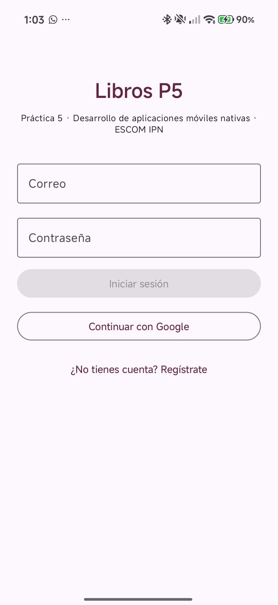 | 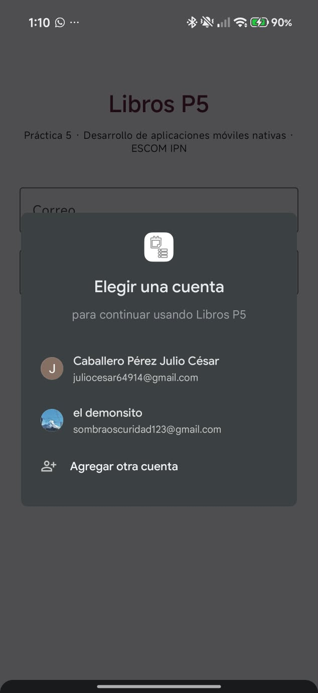 | 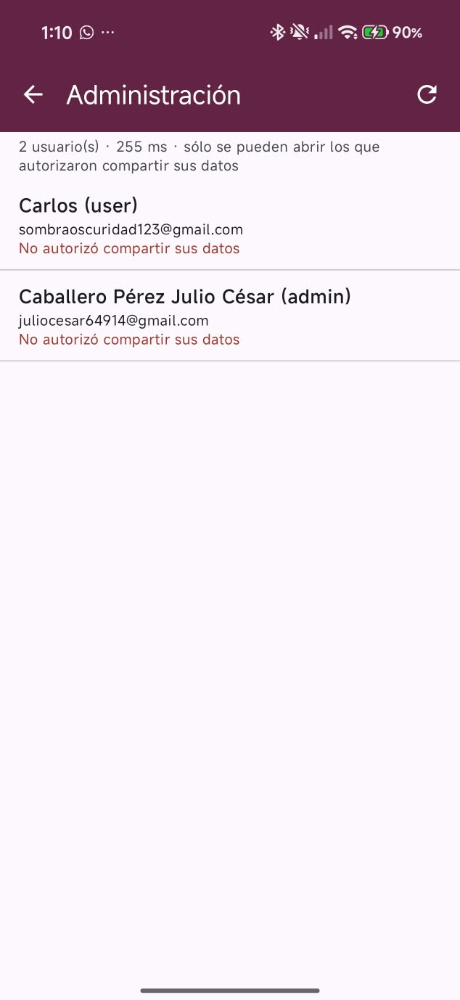 |

| Búsqueda (Open Library) | Detalle | Sin resultados |
|:---:|:---:|:---:|
| 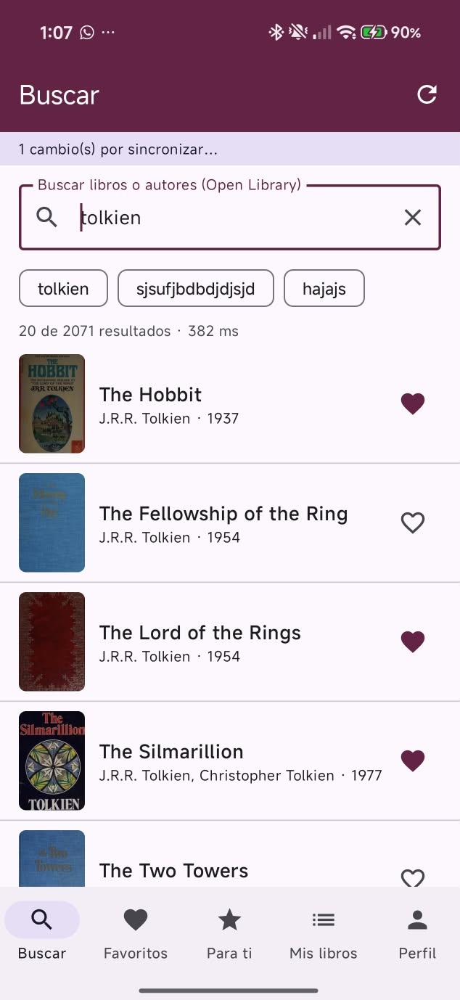 | 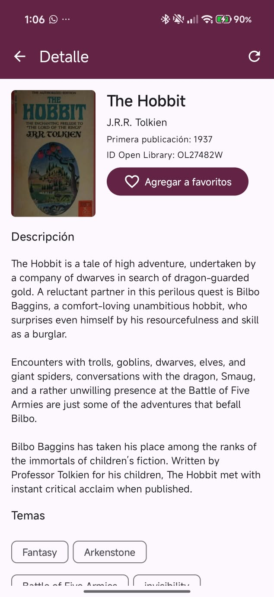 | 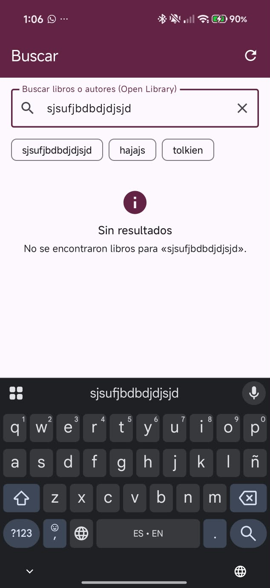 |

| Favoritos | Recomendaciones | Modo offline |
|:---:|:---:|:---:|
| 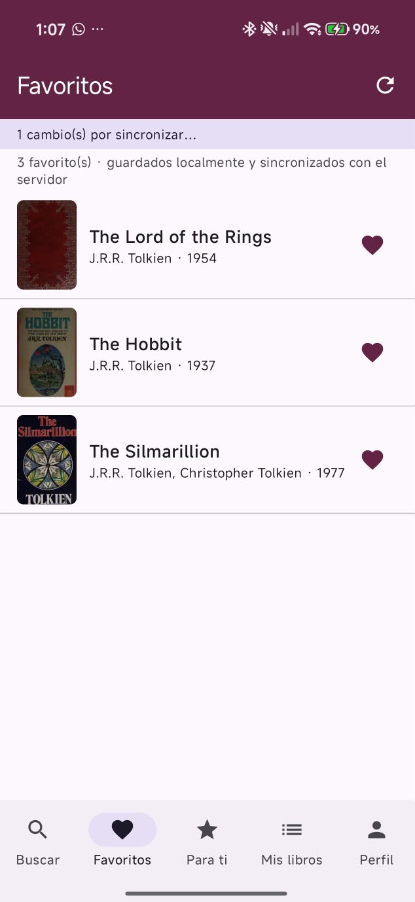 | 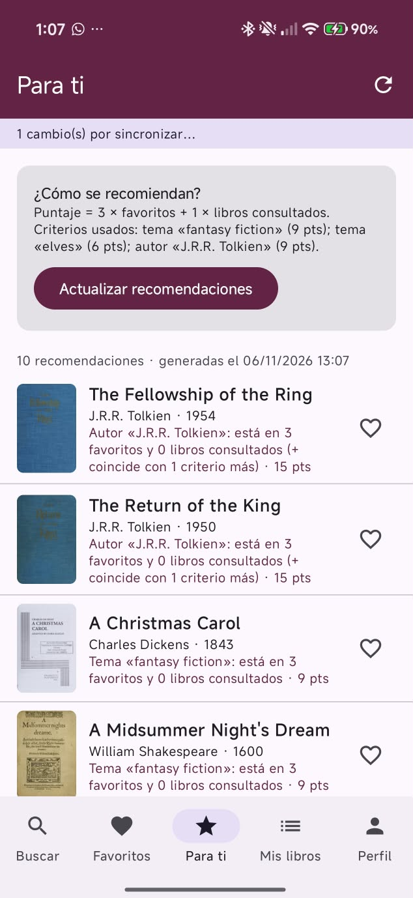 | 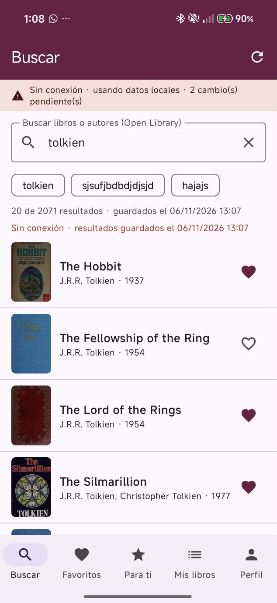 |

| Sincronización | Panel administrador | Mis libros |
|:---:|:---:|:---:|
| 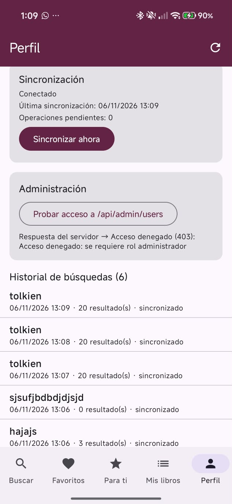 | 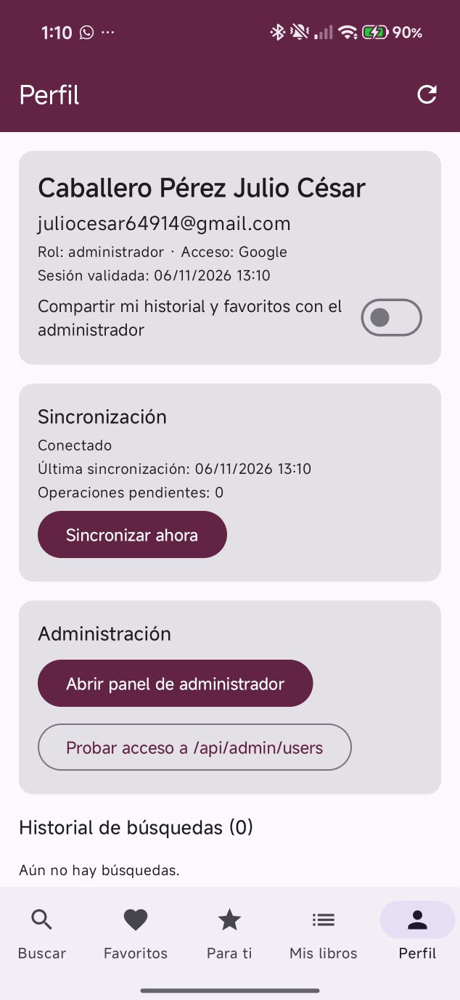 | 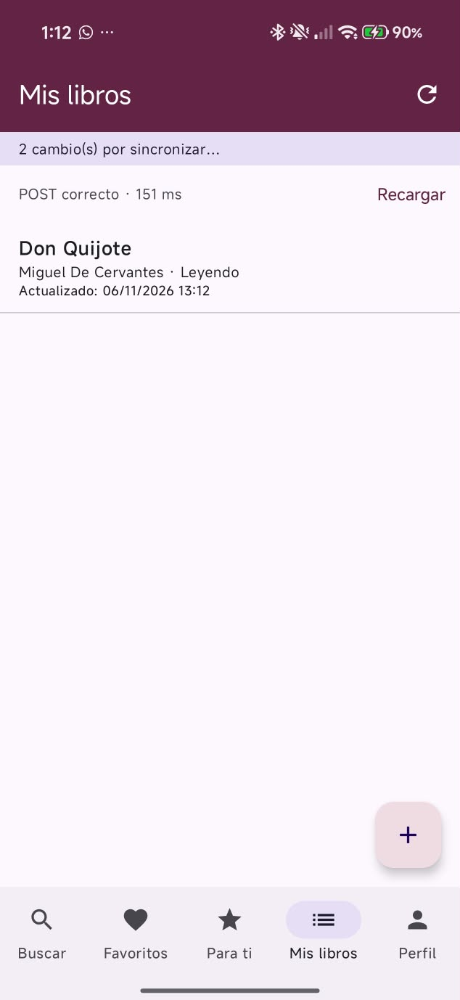 |


## Contribuciones

| Integrante | Aportaciones |
|---|---|
| Caballero Pérez Julio César | Implementación para Android |
| Velazquez Beltran Brandon | Implementación para IOS |

## Herramientas de IA

Se utilizó un asistente de IA (Claude, Anthropic) como apoyo para generar código base y documentación.


